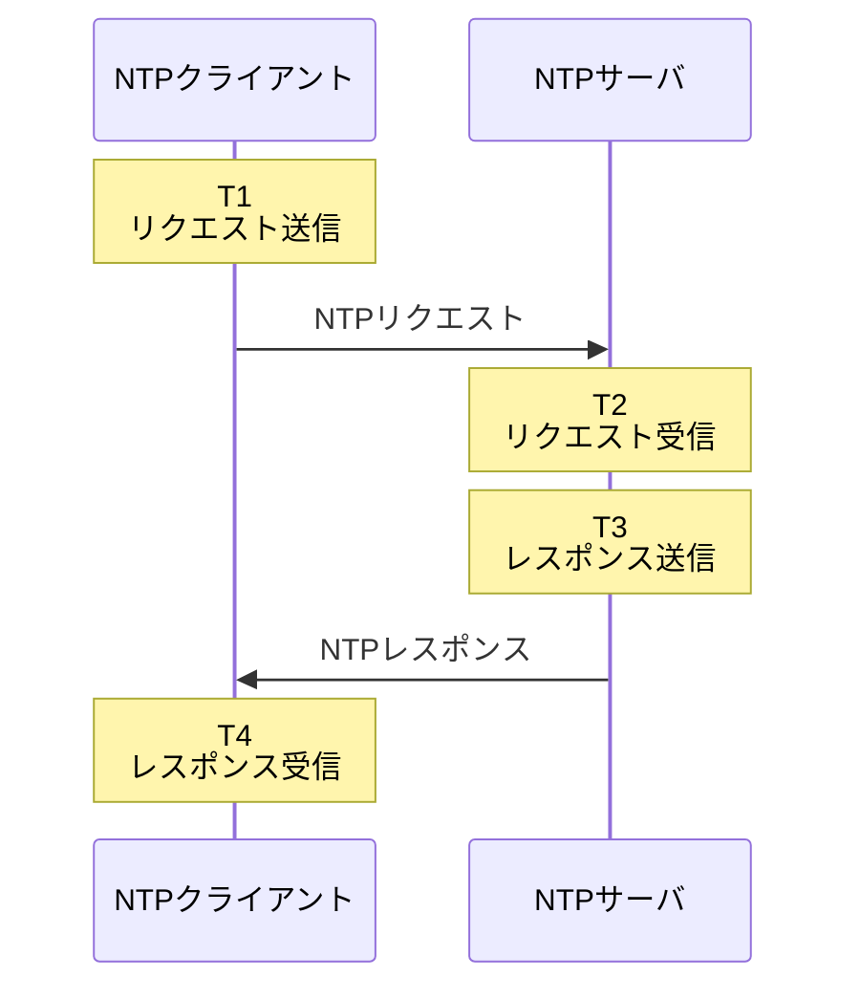
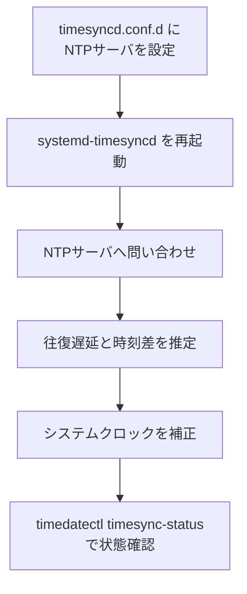

## 今日やったこと
- NTPサーバが何のために使われるのかを整理した
- インターネット越しでも時刻同期できる仕組みを確認した
- NTPでは往復通信のタイムスタンプから通信遅延と時刻差を推定することを確認した
- `ntp.nict.jp` を使ってLinuxの時刻同期先を設定する方法を整理した
- `systemd-timesyncd` の設定と同期状態の確認方法を整理した

## 学んだこと
### NTPサーバとは

NTPは Network Time Protocol の略で、ネットワーク経由でコンピュータの時刻を同期するためのプロトコル。

Linuxサーバなどでは、ログの時刻や認証処理、分散システムなどで時刻のずれが問題になるため、NTPを使って継続的に時計を補正する。

今回は、日本標準時を配信しているNICTのNTPサーバを利用する。

```text
ntp.nict.jp
```

`ntp.nict.jp` は日本標準時に直結したStratum 1のNTPサーバ。

### インターネット越しの通信遅延はどうするのか

NTPサーバから送られてきた時刻をそのままPCに設定すると、ネットワークの通信時間だけ時計がずれてしまう。

NTPでは、クライアントとサーバの間で4つの時刻を記録する。



4つのタイムスタンプから、

```text
T1: クライアントが送信した時刻
T2: サーバが受信した時刻
T3: サーバが返信した時刻
T4: クライアントが受信した時刻
```

を取得する。

NTPはこの情報を使って、

- クライアントとNTPサーバの時刻差
- ネットワークの往復遅延

を推定し、通信時間を考慮しながら時計を補正する。

つまり、

```text
NTPサーバから現在時刻を受け取って
その時刻をそのまま設定する
```

という単純な仕組みではない。

### 通信遅延を完全に補正できるわけではない

NTPでは、行きと帰りの通信遅延がほぼ同じであることを前提として時刻差を推定する。

そのため、

```text
行き: 10ms
帰り: 10ms
```

のような対称的な遅延は補正しやすい。

一方で、

```text
行き: 10ms
帰り: 100ms
```

のように経路や混雑状況によって遅延が大きく異なる場合、その差を完全には補正できない。

NICTでも、`ntp.nict.jp` 自体は日本標準時に非常に高精度で同期しているものの、利用者側ではインターネットの状態によって数ミリ秒から数百ミリ秒程度の誤差が発生する可能性があるとしている。

### LinuxでNTPサーバを設定する

今回は `systemd-timesyncd` を使用する。

設定を直接 `/etc/systemd/timesyncd.conf` に書くこともできるが、ローカル設定はdrop-inファイルとして追加できる。

まずディレクトリを作成する。

```bash
sudo mkdir -p /etc/systemd/timesyncd.conf.d
```

設定ファイルを作成する。

```bash
sudo nano /etc/systemd/timesyncd.conf.d/60-ntp.conf
```

以下を記述する。

```ini
[Time]
NTP=ntp.nict.jp
FallbackNTP=jp.pool.ntp.org
```

`NTP` には優先して使用するNTPサーバを指定する。

`FallbackNTP` は、他に利用可能なNTPサーバ情報がない場合に使用する予備のNTPサーバ。

### 設定を反映する

設定後、`systemd-timesyncd` を再起動する。

```bash
sudo systemctl restart systemd-timesyncd
```

NTPによる時刻同期自体が無効になっている場合は、以下で有効化できる。

```bash
sudo timedatectl set-ntp true
```

### 同期状態を確認する

全体的な状態は以下で確認できる。

```bash
timedatectl status
```

確認したい項目は以下。

```text
System clock synchronized: yes
NTP service: active
```

より詳細な同期状態は以下で確認する。

```bash
timedatectl timesync-status
```

使用中のNTPサーバや、サーバとの時刻差、ネットワーク遅延などを確認できる。

設定から確認までをまとめると、以下の流れになる。



### まとめ

NTPは、単純にサーバから現在時刻を取得するだけではない。

クライアントとNTPサーバ間で複数のタイムスタンプを交換し、

```text
通信の往復遅延
+
クライアントとサーバの時刻差
```

を推定しながら時計を補正する。

Linuxで `systemd-timesyncd` を使う場合は、

```text
/etc/systemd/timesyncd.conf.d/*.conf
```

にNTPサーバを設定し、

```bash
sudo systemctl restart systemd-timesyncd
timedatectl timesync-status
```

で設定反映と同期状態を確認できる。
